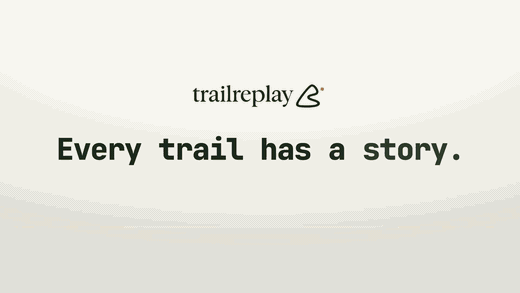

<p align="center">
  
</p>

[English](./README.md) | [繁體中文（台灣）](./README.zh-TW.md)

<p align="center">
  <a href="https://trailreplay.com">
    
  </a>
</p>

[](https://github.com/bresca-ai/TrailReplay/actions/workflows/ci.yml)
[](./LICENSE)
[](https://trailreplay.com)

TrailReplay is a browser-based GPX storytelling studio for runners, cyclists, hikers, and outdoor creators. It turns raw route files into polished, shareable replays with map animation, live stats, elevation, media, and export-ready video, all directly in the browser.

The frontend lives in [`app/`](./app).

> **繁體中文說明：** 請參閱 [繁體中文 README](./README.zh-TW.md)，了解功能、操作限制、本機啟動與測試方式。

## Why It Exists

Most GPX tools stop at route inspection. TrailReplay is built for presentation: turning an activity, a trip, or a comparison between tracks into something easy to review, explain, and share.

## What You Can Do

- Import one or many GPX files and replay them on an interactive 3D map.
- Trim the start and end of a route with a draggable recording timeline, preview it on the map, and download the retained interval as GPX.
- Build a full journey by combining tracks, reordering them, and adding transport segments.
- Display live stats, elevation, pace, and route progress during playback.
- Attach photos to the route from metadata when available or place them manually.
- Add annotations and storytelling moments along the route.
- Compare tracks from the same time window and inspect timing differences.
- Export polished videos with map motion, stats overlays, elevation profile, and branded output.
- Keep the core GPX workflow local in the browser by default.
- Use English, Spanish, Catalan, German, French, or Traditional Chinese (Taiwan) across the editor and help pages.

## Demo Videos

**Path Export with Stats**  
Export a route story with animated map playback, live stats, elevation profile, and branded video output.

https://github.com/user-attachments/assets/73c65611-8348-4b4d-b7c2-af661ab5e75f

[▶ Watch in tutorial](https://trailreplay.com/tutorial.html#demo-videos)

**Comparison Mode**  
Compare two GPX tracks from the same time window and see where each person was at every moment.

https://github.com/user-attachments/assets/c42e5efd-6c08-4591-ab66-92cc16484f24

[▶ Watch in tutorial](https://trailreplay.com/tutorial.html#demo-videos)

> If GitHub does not render the inline previews for your session, you can still watch them in the tutorial or open the original MP4 files in [`media/video/`](./media/video).

## Core Workflow

1. Import GPX tracks.
2. Clean up or combine them into a single journey.
3. Add photos, annotations, and visual context.
4. Replay the route on the map.
5. Export a ready-to-share video.

To trim a route, open **Routes → Trim route** and drag the two handles. The orange interval is retained; green and red markers show its new start and finish. Boundaries snap to recorded points and preserve their timestamps and sensor values. Routes without reliable timestamps use a distance axis. Choose **Download GPX** to export the selection or **Apply to route** to update the route and its statistics. **Restore original** remains available during the current session; saved projects contain only the current route. In this first version, projects containing media, annotations, comparison tracks, camera keyframes or transport segments support preview and GPX download; apply trims before adding those items.

## Live Links

- App: [trailreplay.com](https://trailreplay.com)
- Tutorial: [trailreplay.com/tutorial.html](https://trailreplay.com/tutorial.html)
- GPX download guide: [trailreplay.com/gpx-download-guide.html](https://trailreplay.com/gpx-download-guide.html)

## Local Development

From the repository root:

```bash
npm --prefix app install
npm run dev
```

From the app folder:

```bash
cd app
npm install
npm run dev
```

Useful commands:

```bash
npm run lint
npm run test
npm run build
npm run preview
```

The root scripts delegate to the active frontend in `app/`.

## Contributing and Releases

TrailReplay's source is public under its [attribution license](./LICENSE). Please read the
[contribution guide](./CONTRIBUTING.md) before opening an issue or pull request,
and report security-sensitive issues through the [security policy](./SECURITY.md).

TrailReplay deploys its `main` branch to trailreplay.com through Cloudflare Pages. See the [release runbook](./docs/operations/release-runbook.md) for the release and deployment workflow.

## Stack

- React 19 + TypeScript + Vite for the frontend application.
- MapLibre GL for the interactive map and route playback surfaces.
- Zustand for app state and editor workflows.
- Vitest and Testing Library for test coverage.
- GitHub Discussions for community feedback and feature requests.

## Repository Layout

- `app/`: active TrailReplay frontend, help pages, public assets, and tests
- `functions/`: Cloudflare Pages Functions for the deployed site
- `docs/branding-assets/`: logo files and brand assets used by the project
- `docs/internal/`: maintainer-facing implementation notes and issue writeups
- `media/`: repository media used in documentation and demos
- `docs/operations/`: contributor-facing release and operational runbooks

## Notes

- The active runtime is the browser app inside `app/`.
- Help, tutorial, and GPX guide pages ship alongside the main app.
- GPX processing stays local in the browser by default; community feedback is posted through GitHub Discussions.
